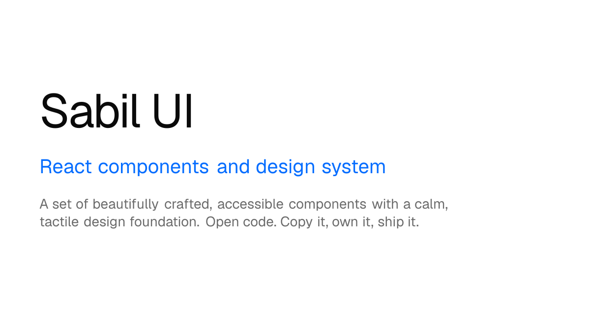

# Sabil UI

**An open-source React component library and design system with a calm, tactile foundation.**
Built on Radix UI and Tailwind CSS v4. Open code: copy it, own it, ship it.

[Website](https://ui.muttaqinsabilul.my.id) ·
[Docs](https://ui.muttaqinsabilul.my.id/docs) ·
[Components](https://ui.muttaqinsabilul.my.id/docs/components) ·
[Motion](https://ui.muttaqinsabilul.my.id/motion) ·
[Example dashboard](https://ui.muttaqinsabilul.my.id/dashboard)



## Features

- **71 components.** Forms, overlays, navigation, data display, plus components for chat and AI agents (bubble, attachment, prompt input and more).
- **One token foundation.** Color, radius, surface and motion live in CSS variables. Change a token and every component follows.
- **Light and dark mode.** Each token has a dark value under the `.dark` class.
- **Accessible.** Built on Radix UI primitives, with keyboard support and screen reader labels.
- **Motion guidelines.** Principles, easing and duration tokens, and 16 ready patterns such as press, hover, drawer and toast stack.
- **Ready for AI editors.** [`/docs/ai.md`](https://ui.muttaqinsabilul.my.id/docs/ai.md) gives an assistant the rules for building with Sabil UI. [`llms.txt`](https://ui.muttaqinsabilul.my.id/llms.txt) and a Markdown copy of every docs page are also available.
- **No React needed.** A plain [HTML, CSS and JS version](https://ui.muttaqinsabilul.my.id/docs/html-css) works on any page.

## Quick start

### React (Next.js + Tailwind CSS v4)

1. Install the base dependencies:

   ```bash
   npm install radix-ui class-variance-authority cn lucide-react tw-animate-css next-themes
   ```

2. Replace `app/globals.css` with the foundation. The file is in
   [`r/theme.json`](https://ui.muttaqinsabilul.my.id/r/theme.json) (`globals.css` and `variants.css`).

3. Add the `cn` helper in `lib/utils.ts`:

   ```ts
   export { cn } from "cn"
   ```

4. Add a component. Copy the source from `https://ui.muttaqinsabilul.my.id/r/<name>.json`
   (field `files[].content`) into `components/ui/<name>.tsx`, then install its `dependencies`.
   Each component page in the docs also shows the source.

Full guide: [Installation](https://ui.muttaqinsabilul.my.id/docs/installation).

### Plain HTML

```html
<link rel="stylesheet" href="https://ui.muttaqinsabilul.my.id/sabil.css">
<script src="https://ui.muttaqinsabilul.my.id/sabil.js" defer></script>
```

### With an AI editor

Paste this prompt into Cursor, Claude Code or a similar tool:

```text
Build [your app] with Sabil UI. Read https://ui.muttaqinsabilul.my.id/docs/ai.md first, then follow its tokens, components and motion rules for every screen.
```

## Run this site locally

```bash
npm install
npm run dev
```

Open http://localhost:3000. The docs are at `/docs`.

| Command | What it does |
| --- | --- |
| `npm run dev` | Start the dev server |
| `npm run build` | Build the static site into `out/` |
| `npm run deploy` | Build and deploy to Cloudflare with Wrangler |
| `npm run typecheck` | Check types |
| `npm run lint` | Run ESLint |

## Project structure

| Path | What it holds |
| --- | --- |
| `app/globals.css` | The foundation: color, radius, surface and motion tokens |
| `components/ui/` | The components. Copy these into other projects |
| `components/examples/` | Live examples shown on the docs pages |
| `components/docs/` | Docs site parts: preview, code block, table of contents |
| `lib/registry.ts` | The list of components, titles and descriptions |
| `scripts/gen-examples.mjs` | Builds the example index. Runs before `dev` and `build` |
| `scripts/gen-ai.ts` | Builds `llms.txt`, Markdown docs, the registry, `sitemap.xml` and `robots.txt` |

## Add a component

1. Put the component in `components/ui/<name>.tsx`.
2. Add a line for it in `lib/registry.ts`.
3. Add examples in `components/examples/<name>-demo.tsx` (and `<name>-*.tsx` for more).
4. Run `npm run dev`. The example index regenerates and the page appears at `/docs/components/<name>`.

## License

MIT, see [`LICENSE`](LICENSE). Some parts are adapted from other open-source projects, such as
shadcn/ui. See [`THIRD-PARTY-LICENSES.md`](THIRD-PARTY-LICENSES.md).

Made by [Sabilul Muttaqin](https://github.com/muttaqinsabilul).
